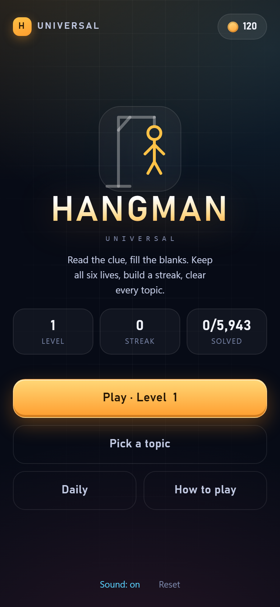

# Hangman Universal

Game đoán từ (hangman) chạy trên web, không cần build, không phụ thuộc thư viện nào.
Mở `index.html` là chơi được; dữ liệu và giao diện tách rời để dễ mở rộng.



## Chạy thử

```bash
# cách 1: mở trực tiếp
start index.html

# cách 2: chạy server nội bộ (test trên điện thoại cùng Wi-Fi)
npm start          # http://localhost:5173
```

`npm start` in ra luôn địa chỉ LAN để mở bằng điện thoại.

## Đang có gì

| Phần | Nội dung |
| --- | --- |
| Ngôn ngữ | Tiếng Anh toàn bộ (câu hỏi lẫn giao diện) |
| Nội dung | 6.532 câu hỏi, 14 chủ đề, 3 mức độ (401 viết tay + 6.131 sinh từ Wikidata) |
| Chế độ | Màn chơi tăng dần, chọn chủ đề, thử thách hằng ngày |
| Luật | 6 mạng, sai 6 lần là thua, đúng hết là thắng |
| Kinh tế | Thưởng xu theo mạng còn lại, độ khó, chuỗi thắng; gợi ý giá 30 xu |
| Lưu tiến độ | `localStorage` (xu, màn, chuỗi, câu đã giải, cài đặt âm thanh) |
| Giao diện | Nền tối "midnight arcade", ô chữ dạng tile phát sáng, bàn phím QWERTY |
| Âm thanh | Tổng hợp bằng WebAudio, không cần file âm thanh |

## Cấu trúc

```
index.html            # 3 màn hình: home / chủ đề / chơi + overlay kết quả
styles.css            # toàn bộ theme, biến màu ở :root
src/core.js           # logic thuần: mask, mạng, xu, thứ tự màn, daily seed
src/app.js            # UI, sự kiện, lưu trữ, âm thanh
data/questions.js     # 401 câu viết tay + 14 chủ đề (kèm icon SVG)
data/questions.generated.js  # 6.131 câu sinh tự động (file build ra, đừng sửa tay)
tools/generate.mjs    # sinh ngân hàng câu hỏi từ Wikidata (CC0)
tools/validate.mjs    # kiểm tra dữ liệu trước khi phát hành
tools/import.mjs      # nhập hàng loạt từ CSV/JSON (có dry-run + backup)
tools/test-core.mjs   # 14 test cho logic
tools/smoke.mjs       # chơi thật một ván trong Chrome headless: 13 check
tools/shoot.mjs       # chụp ảnh giao diện bằng Chrome headless (CDP)
tools/serve.mjs       # server tĩnh để test trên điện thoại
.shots/               # ảnh chụp các màn hình, dùng cho README / store listing
```

## Thêm câu hỏi

Mỗi câu là một dòng trong mảng `RAW` của `data/questions.js`:

```
'chủ-đề|câu hỏi|ĐÁP ÁN|độ-khó'
```

Ví dụ:

```js
'geo|Which country has the city of Osaka?|JAPAN|1'
```

Quy tắc:

- `chủ-đề` phải là một trong 12 id: `animals, food, geo, science, movies, music, sports, history, tech, objects, jobs, body`
- `ĐÁP ÁN` chỉ gồm `A–Z` và dấu cách, tối đa 16 ký tự, không dấu
- `độ-khó` là `1`, `2` hoặc `3`
- câu hỏi nên ngắn (dưới ~90 ký tự) để vừa thẻ gợi ý

Sau khi sửa, chạy:

```bash
npm run check      # validate dữ liệu + chạy test logic
```

Lệnh này bắt: sai định dạng đáp án, trùng id, trùng câu hỏi, đáp án quá dài,
chủ đề thiếu câu theo từng độ khó.

## Nhập câu hỏi từ file (CSV / JSON)

Khi có sẵn danh sách trong Excel/Sheets hoặc file JSON, không cần sửa tay:

```bash
node tools/import.mjs examples/sample-import.csv --dry   # xem trước
node tools/import.mjs examples/sample-import.csv         # ghi thật
```

CSV cần dòng đầu là header `category,question,answer,difficulty` (thứ tự cột tuỳ ý,
ô có dấu phẩy thì bọc trong ngoặc kép):

```csv
category,question,answer,difficulty
geo,"Which country is famous for fjords, glaciers and the midnight sun?",NORWAY,2
animals,Which colourful bird can mimic human speech?,PARROT,1
```

JSON nhận mảng object hoặc mảng chuỗi cùng định dạng:

```json
[{ "category": "geo", "question": "Which country has the city of Oslo?", "answer": "NORWAY", "difficulty": 2 }]
```

Công cụ sẽ:

1. chuẩn hoá đáp án (bỏ dấu, viết hoa, gộp khoảng trắng) và kiểm tra từng dòng
2. bỏ qua câu trùng (so khớp câu hỏi sau khi bỏ dấu câu), cảnh báo nếu đáp án đã dùng
3. **không ghi gì cả** nếu có dòng lỗi (trừ khi thêm `--force` để chỉ nhập dòng hợp lệ)
4. backup `data/questions.js` vào `.backup/` rồi mới ghi, sau đó tự chạy lại validator

## Ngân hàng sinh tự động (6.131 câu)

`data/questions.generated.js` được sinh từ **Wikidata (CC0)** bằng
`tools/generate.mjs` — dữ liệu kiện, không phải văn bản có bản quyền.

```bash
npm run generate     # ~3 phút, gọi 12 truy vấn SPARQL rồi ghi lại file
```

12 loại dữ kiện đang dùng:

| Loại | Câu hỏi dạng | Số câu |
| --- | --- | --- |
| city | In which country is the city of X? | 1.417 |
| book | Who wrote the book X? | 824 |
| lake | In which country is the lake X? | 720 |
| band | Which country does the band X come from? | 573 |
| film | Who directed the film X? | 564 |
| university | In which country is X located? | 489 |
| mountain | In which country is the mountain X? | 424 |
| painting | Who painted X? | 366 |
| river | In which country does the river X flow? | 294 |
| capital | What is the capital of X? | 204 |
| currency | Which currency is used in X? | 116 |
| element | The symbol X stands for which element? | 118 |

Mỗi câu qua các bước lọc: bỏ nhãn mơ hồ (cùng chủ thể mà 2 đáp án),
cắt hậu tố lặp ("... River", "... University"), bỏ tên nguyên tố tạm,
giới hạn 3–16 ký tự, khử trùng câu, và giới hạn số câu dùng chung một đáp án.

**Điều phải biết:** vì Wikidata mạnh nhất về địa lý, 56% ngân hàng là Geography.
Hệ quả là trong chế độ màn chơi, khoảng **1/4 màn lặp lại chủ đề của màn trước**
(không thể ít hơn về mặt toán học khi một chủ đề chiếm quá nửa). Nếu muốn giảm,
cách đúng là sinh thêm dạng câu khó–dễ khác cho các chủ đề còn mỏng
(đồ ăn, thể thao, nghề nghiệp, cơ thể), không phải sửa bộ xếp lịch.

## Cơ chế dữ liệu đang chạy

```
data/questions.js  (RAW: "chủ-đề|câu hỏi|ĐÁP ÁN|độ khó")
        |
        |  parse 1 lần lúc load, tách bằng dấu |
        v
{ id, category, question, answer, difficulty }
        |
        +--> core.buildLevelOrder()  -> thứ tự màn chơi (dễ trước, trộn chủ đề)
        +--> core.byCategory()       -> danh sách theo chủ đề
        +--> core.mask()/status()    -> trạng thái ô chữ trong ván
```

- Dữ liệu là file tĩnh, nạp bằng `<script>` chứ không `fetch`, nên chạy được
  cả khi mở `index.html` trực tiếp (không dính CORS).
- Hai tầng dữ liệu: `questions.js` (viết tay, sửa thoải mái) và
  `questions.generated.js` (sinh lại bất cứ lúc nào, không sửa tay).
  `questions.js` gộp hai tầng lúc load.
- `id` sinh từ **nội dung** (hash của chủ đề + câu hỏi + đáp án), không phải số thứ tự.
  Nhờ vậy chèn/xoá/sắp xếp lại câu hỏi không làm hỏng tiến độ đã lưu; khi load,
  các id không còn tồn tại được dọn khỏi `localStorage`.
- Không có màn hình import bên trong app: dữ liệu đi theo bản build. Nếu sau này
  muốn người chơi tự nhập bộ câu của họ (ví dụ giáo viên tạo đề), lúc đó mới cần
  thêm màn hình import + lưu vào `localStorage`/`IndexedDB`.

## Thêm chủ đề mới

1. Thêm một object vào `CATEGORIES` trong `data/questions.js`
   (`id`, `name`, `icon` là chuỗi SVG, `tint` là mã màu).
2. Thêm câu hỏi với id chủ đề đó.
3. Không cần sửa code khác — danh sách chủ đề tự render từ dữ liệu.

Icon đang dùng là SVG stroke `currentColor` nên tự ăn màu `tint`.

## Điều chỉnh độ khó / kinh tế

- Số mạng: `MAX_LIVES` trong `src/core.js` (mặc định 6)
- Giá gợi ý: `HINT_COST` (mặc định 30)
- Công thức thưởng: `coinsForWin()` — nền 20, mỗi mạng +5, độ khó +10/bậc,
  chuỗi +3 (tối đa 5 chuỗi), thắng không sai chữ nào +15
- Thứ tự màn: `buildLevelOrder()` xếp câu dễ trước, trộn đều chủ đề,
  có bước làm mượt để không lặp chủ đề liền nhau. Seed cố định nên mọi người
  chơi cùng thứ tự màn.

## Ghi chú về nội dung

Toàn bộ 395 câu trong repo này được viết mới cho dự án, không sao chép từ
ứng dụng nào trên Play Store. Cơ chế chơi hangman là phổ quát, nhưng câu hỏi,
thứ tự màn, hình vẽ và âm thanh của app khác là tài sản có bản quyền — dùng lại
sẽ dính DMCA và có thể bị khoá tài khoản developer.

Nếu cần ngân hàng lớn hơn:

- viết thêm theo đúng định dạng trên (nhanh nhất, chất lượng nhất)
- sinh nháp bằng LLM rồi tự kiểm tra lại từng câu
- tham khảo dữ liệu mở: Wiktionary, Wikidata, danh sách từ theo tần suất

## Bước tiếp theo (chưa làm)

- Toàn bộ UI đang là tiếng Anh (khớp với ngân hàng câu hỏi). Nếu sau này cần
  bản khác ngôn ngữ: chuỗi hiển thị nằm gọn trong `index.html` và `src/app.js`,
  tách ra một file `src/strings.js` là dịch được, không phải sửa logic
- Đóng gói lên Play Store: Capacitor hoặc TWA, cần icon 512px + keystore
- Thêm chế độ hai người, nhiệm vụ hằng ngày, bảng xếp hạng
- Hình minh hoạ riêng thay cho hình que vẽ bằng SVG (nếu muốn khác biệt hơn nữa)

## Lệnh có sẵn

```bash
npm start        # server tĩnh
npm run import -- examples/sample-import.csv   # nhập câu hỏi từ CSV/JSON
npm run generate     # sinh lại toàn bộ ngân hàng từ Wikidata
npm run check    # validate + test (nhanh, không cần Chrome)
npm run smoke    # chơi thật 1 ván + kiểm tra lưu tiến độ (cần Chrome)
npm run shots    # chụp lại .shots/
```
